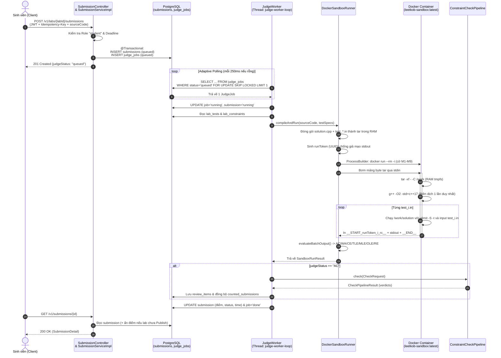

# Luồng Xử Lý Toàn Cục Thực Tế Trong Mã Nguồn (`END_TO_END_CODE_TRACE.md`)

Tài liệu này truy vết **chính xác từng file, từng hàm và từng bước xử lý** của hệ thống LeeTKOB từ lúc Backend nhận mã nguồn C++ của sinh viên cho đến khi Docker Sandbox chấm xong và trả kết quả về API.

---

## 1. Sơ đồ Trình tự Toàn Cục (Sequence Diagram)



---

## 2. Truy vết Chi tiết Từng Giai đoạn trong Code

### Giai đoạn 1: Tiếp nhận bài nộp & Đưa vào hàng đợi (HTTP Thread)

1. **Điểm vào HTTP Controller** — [SubmissionController.java](file:///d:/ALL_SOURCE_CODE/Learning/AWEB/LastPrj/LeeTKOB-AWAD/backend/src/main/java/com/leetkob/controllers/SubmissionController.java)
   - Hàm `submitLab(...)` nhận `POST /v1/labs/{labId}/submissions` kèm header `Idempotency-Key`, `traceparent` và body `SubmitRequest` (`sourceCode`).
   - Gọi `authHelper.requireRole("student")` — từ chối ngay với `401` nếu chưa đăng nhập hoặc `403` nếu tài khoản là `ta`/`admin`.
   - Gọi xuống `submissionService.submit(...)`.

2. **Kiểm tra nghiệp vụ & Lưu nguyên tử** — [SubmissionServiceImpl.java](file:///d:/ALL_SOURCE_CODE/Learning/AWEB/LastPrj/LeeTKOB-AWAD/backend/src/main/java/com/leetkob/services/impl/SubmissionServiceImpl.java)
   - Hàm `submit(...)` chạy trong `@Transactional`:
     - Tìm `Lab` theo `labId` (`404 NOT_FOUND` nếu không tồn tại).
     - Kiểm tra `lab.getDeadline()`: nếu `Instant.now().isAfter(deadline)` $\rightarrow$ ném `ProblemException(ProblemKind.DEADLINE_PASSED)` (`409 Conflict`), không ghi DB.
     - Kiểm tra `Idempotency-Key` qua `submissionRepository.findByLabIdAndStudentIdAndIdempotencyKey(...)`: nếu đã tồn tại thì trả về bản ghi cũ, không tạo job trùng.
     - Tạo bản ghi `Submission` với `judgeStatus = "queued"`, `sourceCode`, `traceId` và lưu vào bảng `submissions`.
     - Tạo bản ghi `JudgeJob` với `status = "queued"` trỏ tới `submission` vừa tạo và lưu vào bảng `judge_jobs`.
   - Controller trả ngay **`201 Created`** (`SubmissionSummary`) cho sinh viên mà **không phải chờ** quá trình biên dịch C++.

---

### Giai đoạn 2: Worker Bốc Job Bất đồng bộ (Background Thread)

1. **Khởi động Thread Polling** — [JudgeWorker.java](file:///d:/ALL_SOURCE_CODE/Learning/AWEB/LastPrj/LeeTKOB-AWAD/backend/src/main/java/com/leetkob/worker/JudgeWorker.java)
   - Khi Spring Boot khởi động, hàm `init()` (`@PostConstruct`) kiểm tra biến `leetkobRole` (`LEETKOB_ROLE`, mặc định `all` cho dev, `worker` khi deploy).
   - Nếu hợp lệ, `startWorkerLoop()` tạo thread daemon tên `judge-worker-loop` chạy vòng lặp `while (running.get())`.
   - Cơ chế **Adaptive Polling**: gọi `processNextJob()`; nếu trả về `true` (vừa xử lý xong 1 job) thì vòng lặp quét tiếp ngay lập tức; nếu trả về `false` (hàng đợi rỗng) thì `Thread.sleep(250)` để tiết kiệm CPU/DB.

2. **Bốc job & Chuẩn bị dữ liệu chấm** — `JudgeWorker.processNextJob()` (`@Transactional`)
   - Gọi `judgeJobRepository.findNextQueuedJobForUpdate()` chạy SQL gốc `SELECT * FROM judge_jobs WHERE status = 'queued' ORDER BY id ASC FOR UPDATE SKIP LOCKED LIMIT 1` để đảm bảo mỗi job chỉ bị đúng 1 Worker bốc (**Exact-Once Q1**).
   - Đổi trạng thái `job.status = "running"`, `submission.judgeStatus = "running"`, lưu `lockedAt` và `lockedBy`.
   - Truy vấn `labTestRepository.findByLabIdOrderByOrderIndexAsc(lab.getId())` và chuyển đổi sang danh sách `List<TestCaseSpec>`.
   - Gọi `sandboxRunner.compileAndRun(submission.getSourceCode(), testSpecs)`:
     - Nếu `LEETKOB_SANDBOX_ENABLED=true` $\rightarrow$ Spring nạp **`DockerSandboxRunner`**.
     - Nếu `LEETKOB_SANDBOX_ENABLED=false` (mặc định khi test nội bộ) $\rightarrow$ Spring nạp **`MockSandboxRunner`**.

---

### Giai đoạn 3: Giao tiếp Docker Sandbox, Biên dịch & Chạy C++

Toàn bộ logic nằm trong [DockerSandboxRunner.java](file:///d:/ALL_SOURCE_CODE/Learning/AWEB/LastPrj/LeeTKOB-AWAD/backend/src/main/java/com/leetkob/sandbox/DockerSandboxRunner.java) kết hợp với image đã build sẵn từ [Dockerfile](file:///d:/ALL_SOURCE_CODE/Learning/AWEB/LastPrj/LeeTKOB-AWAD/sandbox/Dockerfile).

1. **Đóng gói In-Memory (`compileAndRun` $\rightarrow$ `buildTarArchive`)**
   - Java không tạo thư mục tạm hay dùng host mount `-v`.
   - Toàn bộ `solution.cpp` và các tệp đầu vào `test_0.in`, `test_1.in`, ... được nén ngay trong RAM thành 1 mảng byte định dạng POSIX USTAR `tar` qua `buildTarArchive()` và `createTarHeader()`.

2. **Sinh `runToken` & Dựng Script chạy Batch (`buildBatchInnerScript`)**
   - Sinh `runToken` ngẫu nhiên bằng `UUID` để làm chuỗi phân tách ranh giới stdout giữa các test case (ngăn sinh viên `std::cout` giả mạo kết quả).
   - Kịch bản shell bên trong container thực hiện tuần tự:
     1. `tar -xf - -C /work`: Giải nén mã nguồn và tất cả input vào RAM disk `/work`.
     2. `TMPDIR=/work g++ -O2 -std=c++17 /work/solution.cpp -o /work/solution`: Biên dịch **1 lần duy nhất**. Nếu lỗi, in `__LEETKOB_CE__` ra `stderr` và thoát ngay với mã `200`.
     3. Vòng lặp chạy từng `test_i.in` với `(ulimit -S -t <cpuSec>; /work/solution < /work/test_i.in > /work/out_i.txt)`:
        - In `__START_<runToken>_<i>_<rc>__`.
        - Nếu `rc == 0`, cắt tối đa `1 MiB + 1 byte` từ `out_i.txt`, xóa ngay `out_i.txt` để giải phóng RAM `tmpfs`, in `__END_<runToken>_<i>__`.
        - Nếu `rc != 0` (gặp `TLE`/`MLE`/`RE`), `break` dừng sớm các test sau.

3. **Dựng lệnh Docker 9 Rào chắn (`buildDockerBaseCommand`)**
   - Gắn đầy đủ 9 cờ bảo vệ `M1–M9`:
     - `--rm -i --name leetkob-sbx-<uuid>`
     - `--network=none` (`M1`: cắt mạng)
     - `--cpus=1` (`M2`: giới hạn CPU)
     - `--memory=<mem>m --memory-swap=<mem>m` (`M4`: khóa RAM, cấm swap)
     - `--pids-limit=32` (`M5`: chặn fork bomb)
     - `--read-only --tmpfs /work:rw,exec,nosuid,nodev,size=64m,uid=10001,gid=10001` (`M7`, `M8`: ổ đĩa gốc chỉ đọc, chỉ cho phép chạy trên RAM tạm `/work`)
     - `--user 10001:10001 --cap-drop=ALL --security-opt=no-new-privileges` (`M7`: non-root, gỡ toàn bộ quyền kernel)
     - Không truyền biến môi trường host hay file `.env` (`M9`).

4. **Thực thi & Giám sát từ Java (`runContainerProcess`)**
   - Khởi chạy `ProcessBuilder`, đẩy gói `tar` vào `process.getOutputStream()` (`stdin`) rồi đóng luồng.
   - Mở 2 thread song song (`sbx-stdout`, `sbx-stderr`) gọi `readStreamCapped()` để đọc luồng kết quả trong giới hạn bộ nhớ an toàn (`M6`). Nếu vượt ngưỡng, lập tức gọi `forceKillContainer()` (`docker rm -f`).
   - Thread chính đợi `process.waitFor(wallClockLimitMs)`. Nếu quá giờ (`M3`), lập tức gọi `forceKillContainer()` và trả về `timedOut = true` (`TLE`).

5. **Phân tích kết quả (`evaluateBatchOutput`)**
   - Kiểm tra lỗi toàn cục trước (`CE` mã `200`, `timedOut` $\rightarrow$ `TLE`, `137` $\rightarrow$ `MLE`).
   - Tìm từng cặp `__START_<runToken>_<i>_<rc>__` ... `__END_<runToken>_<i>__`.
   - Phân loại exit code (`152` $\rightarrow$ `TLE`, `137` $\rightarrow$ `MLE`, khác `0` $\rightarrow$ `RE`).
   - So sánh output thực tế với `expectedOutput` qua `outputsMatch()` (chuẩn hóa `\r\n` $\rightarrow$ `\n` và bỏ khoảng trắng cuối) để tính `passedTests` và chốt `AC` hoặc `WA`.

---

### Giai đoạn 4: Kiểm tra Ràng buộc & Lưu Kết quả (Atomic Commit)

Quay lại `JudgeWorker.processNextJob()`:
1. Ghi nhận `passedTests`, `totalTests`, `executionTimeMs`, `compileError`, và tính điểm thô `scoreTenths = (passedTests * 100) / totalTests`.
2. Nếu `judgeStatus` là `"AC"`:
   - Gọi `constraintCheckPipeline.check(checkRequest)` (hiện tại là `MockConstraintCheckPipeline`, sau khi TV3 hoàn thành sẽ tự thay bằng bean kiểm tra AST/LLM thật).
   - Lưu danh sách vi phạm vào bảng `review_items` và gọi `syncCountedSubmission()` để đảm bảo khớp khóa ngoại với bảng `counted_submissions` của tính năng Publish (`PA#2`).
3. Chốt `submission.judgeStatus`, `job.status = "done"`, `job.finishedAt = OffsetDateTime.now()` và commit transaction.

---

### Giai đoạn 5: Sinh viên / TA Xem Kết quả

- Client gọi `GET /v1/submissions/{id}` $\rightarrow$ `SubmissionController.getSubmissionDetail()` $\rightarrow$ `SubmissionServiceImpl.getSubmissionDetail()`.
- Nếu người gọi là `student` nhưng không phải chủ bài nộp $\rightarrow$ trả về **`404 Not Found`** (chống dò ID bài của bạn khác).
- Kiểm tra `isLabPublished(labId)`:
  - **Chưa Publish:** Trả về trạng thái chấm (`queued` / `running` / `AC` / `WA` / `CE`...), `passedTests`, `totalTests`, `compileError`, nhưng **ép `publishedScoreTenths = null` và `publishedDeductions = null`** để không lộ điểm trước thời hạn.
  - **Đã Publish:** Trả về đầy đủ điểm chốt và các mục trừ điểm vi phạm.


---

## 3. Bản chất Phân biệt: `docker build` (Khởi tạo sẵn) vs `docker run` (Chấm bài)

### 3.1. Lúc khởi động server (Chỉ làm 1 lần duy nhất từ trước):
- Docker thực hiện **`docker build`** từ file `sandbox/Dockerfile` để tạo sẵn một **Image** tên là `leetkob-sandbox:latest` (trong đó đã cài sẵn `g++`, tạo sẵn user `10001:10001`, thư mục `/work`):
  ```bash
  docker build -t leetkob-sandbox:latest ./sandbox
  ```
- **Local Dev:** Chạy 1 lần trên máy cá nhân, image nằm sẵn trong Docker Engine (`docker images`).
- **CI GitHub Actions:** Step build image chạy trước khi chạy test sandbox.
- **Production Server:** Build sẵn hoặc pull từ Docker Registry (Docker Hub / GHCR).

---

### 3.2. Khi có sinh viên nộp bài (Luồng chạy cho mỗi bài nộp):

1. **Backend đóng gói in-memory:**
   - Backend lấy mã C++ và toàn bộ file `test_0.in`, `test_1.in`, ... nén thành một mảng byte định dạng **`tar` ngay trong RAM** (không ghi file ra ổ đĩa máy chủ).

2. **Backend tạo Container bằng `docker run` (không phải `docker build`):**
   - Backend gọi `ProcessBuilder` chạy lệnh:
     ```bash
     docker run --rm -i \
       --network=none \
       --memory=256m --memory-swap=256m \
       --pids-limit=32 \
       --read-only --tmpfs /work:rw,exec,size=64m \
       --user 10001:10001 --cap-drop=ALL --security-opt=no-new-privileges \
       leetkob-sandbox:latest sh -c "..."
     ```
   - Lệnh này gắn đủ **9 cờ bảo vệ M1–M9** và tạo ra container chỉ mất **khoảng 0.1 – 0.2 giây** (vì image đã có sẵn).

3. **Backend bơm gói `tar` qua `stdin`:**
   - Backend mở luồng `process.getOutputStream()` và đẩy thẳng mảng byte `tar` vào `stdin` của container.
   - Container hứng lấy và chạy lệnh `tar -xf - -C /work` để bung `solution.cpp` và các file input vào RAM ảo `/work`.

4. **Sandbox biên dịch `g++` và chạy test:**
   - Container tự gọi `g++ -O2 solution.cpp -o solution` (dùng trình biên dịch `g++` đã có sẵn trong image) **đúng 1 lần duy nhất**.
   - Sau đó chạy vòng lặp cho từng test case: `./solution < test_i.in > out_i.txt`.

5. **Sandbox bắn kết quả qua `stdout`/`stderr` cho Backend:**
   - Container in kết quả qua `stdout` kèm mã phân tách bí mật `runToken` (`__START_<token>_i_rc__`, kết quả output, `__END_<token>_i__`).
   - Backend đọc `stdout`, so khớp với đáp án mẫu (`expectedOutput`) để chấm `AC`/`WA`/`TLE`/`MLE`/`CE`.
   - Chấm xong, container tự động biến mất (`--rm`), không để lại bất kỳ file rác nào trên máy chủ.

