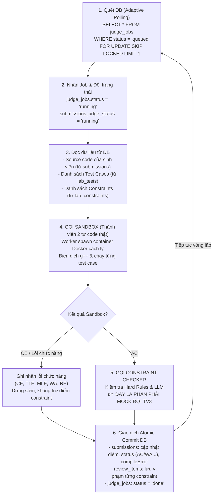

# Sơ đồ & Luồng Chạy Chi tiết của Worker và C++ Sandbox

> **Phụ trách:** Thành viên 2 — Lê Trung Thành Đạt (`23120228`)  
> **Trụ cột Kỹ thuật:** Async Queue & Separate Worker (`Q1`), C++ Docker Sandbox (`F4`, `M1–M9`).

---

## 1. Sơ đồ Luồng Hoạt động Tổng thể



---

## 2. Chi tiết Từng Bước trong Chu trình

### Bước 1: Quét DB Hàng đợi (`Adaptive Polling`)
- Worker chạy vòng lặp tuần tự hỏi PostgreSQL:
  ```sql
  SELECT * FROM judge_jobs 
  WHERE status = 'queued' 
  ORDER BY id ASC 
  FOR UPDATE SKIP LOCKED 
  LIMIT 1;
  ```
- **Cơ chế Adaptive Polling:**
  - Nếu bốc được job: Tiến hành xử lý ngay, sau khi xử lý xong quét tiếp ngay lập tức mà không chờ (drain-the-queue).
  - Nếu không có job (hàng đợi rỗng): Tạm dừng (`Thread.sleep(250)` hoặc `500ms`) để tránh quá tải CPU/DB.
- Khóa `FOR UPDATE SKIP LOCKED` đảm bảo nếu mở rộng chạy 2 hay nhiều container Worker cùng lúc cũng không bao giờ bị tranh chấp hoặc xử lý trùng 1 bài nộp.

### Bước 2: Khóa Trạng thái Job
- Cập nhật trong DB:
  - `judge_jobs.status = 'running'`
  - `submissions.judge_status = 'running'`
- Ghi nhận thời điểm nhận job (`locked_at = now()`) và định danh worker (`locked_by`).

### Bước 3: Nạp Dữ liệu Đầu vào
- Đọc mã nguồn C++ của sinh viên từ `submissions.source_code`.
- Đọc danh sách Test Cases của bài lab từ `lab_tests` (`input_data`, `expected_output`, `time_limit_ms`, `memory_limit_mb`).
- Đọc danh sách ràng buộc từ `lab_constraints` (`constraint_id`, `constraint_type`, `description`, `deduction_tenths`).

---

### Bước 4: Chạy C++ Docker Sandbox (Phần code thật của TV2)

Container Sandbox được khởi tạo với 9 rào chắn an ninh (`M1–M9`):
```bash
docker run --rm \
  --network=none \
  --memory=256m --memory-swap=256m \
  --pids-limit=32 \
  --read-only --tmpfs /work:rw,size=64m \
  --user 10001:10001 --cap-drop=ALL --security-opt=no-new-privileges \
  leetkob-sandbox:latest ...
```

#### Giai đoạn 4.1: Biên dịch mã nguồn (`g++`)
- Lệnh: `g++ -O3 -std=c++20 solution.cpp -o solution`
- Đọc **Exit Code** và **`stderr`**:
  - Nếu `Exit Code != 0` $\rightarrow$ **Lỗi biên dịch (`CE` - Compile Error)**:
    - Thu thập toàn bộ nội dung `stderr` (dòng báo lỗi syntax của g++).
    - Lưu vào `compile_error`.
    - **Dừng ngay tại đây**, chuyển thẳng sang Bước 6 (không tốn chi phí chạy test cases hay gọi LLM).
  - Nếu `Exit Code == 0` $\rightarrow$ Biên dịch thành công, sinh ra file binary `./solution`.

#### Giai đoạn 4.2: Chạy Test Cases & Phán quyết Trạng thái
Chạy tuần tự `./solution < input.txt > output.txt` trên từng test case:

| Trạng thái | Điều kiện phát hiện |
| :---: | :--- |
| **`TLE`** *(Time Limit)* | Quá CPU limit (`ulimit -t 2`) hoặc Host chờ quá wall-clock timeout $\rightarrow$ Host ngắt container. |
| **`MLE`** *(Memory Limit)* | Dùng quá 256MB RAM $\rightarrow$ Docker OOM Killer ngắt tiến trình (Exit Code = 137). |
| **`RE`** *(Runtime Error)* | Chia cho 0, Segmentation Fault, tràn mảng $\rightarrow$ Exit Code khác 0 (139, 134...). |
| **`WA`** *(Wrong Answer)* | Code chạy xong (Exit Code = 0), nhưng nội dung file `output.txt` **khác** `expected_output.txt`. |
| **`AC`** *(Accepted)* | Code chạy xong (Exit Code = 0), và file `output.txt` **khớp 100%** `expected_output.txt` trên **toàn bộ** test cases. |

---

### Bước 5: Gọi Constraint Checker (👉 PHẦN PHẢI MOCK ĐỢI TV3)

- **Khi nào gọi:** Chỉ khi mã nguồn C++ chạy thành công chức năng (hoặc đạt `AC`).
- **Giao tiếp qua Interface:** `ConstraintCheckPipeline.check(CheckRequest)`
- **Tại sao phải Mock:**
  - Thành viên 3 phụ trách viết bộ quét cú pháp Hard Rules (`D1`) và gọi LLM Semantic (`G1–G5`).
  - Trong lúc TV3 đang làm, TV2 sử dụng `MockConstraintCheckPipeline` trả về:
    - `verdict = "pass"` cho mọi constraint.
    - `evidence = []`
    - `callLogs = []`
- **Tác dụng:** Giúp luồng Worker của TV2 chạy trơn tru từ A đến Z, test độc lập mà không bị kẹt hay phụ thuộc tiến độ của TV3.

---

### Bước 6: Lưu Kết quả (Atomic Transaction)

Thực hiện đồng thời trong 1 giao dịch SQL:
1. **Bảng `submissions`:**
   - Cập nhật `judge_status` (`AC`, `WA`, `TLE`, `MLE`, `RE`, `CE`).
   - Cập nhật điểm `score_tenths` (điểm test trừ đi điểm vi phạm constraint nếu có).
   - Cập nhật `passed_tests`, `total_tests`, `execution_time_ms`, `memory_kb`, `compile_error`.
   - Cập nhật `judged_at = now()`.
2. **Bảng `review_items`:**
   - Lưu phán quyết của từng constraint (`pass`, `violation`, `unsure`) kèm dòng bằng chứng `evidence_json`.
3. **Bảng `judge_jobs`:**
   - Cập nhật `status = 'done'`, `finished_at = now()`.

Sau khi Transaction commit thành công, Worker tiếp tục quay về **Bước 1** để bốc bài nộp tiếp theo.
