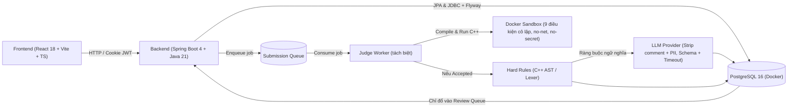

# Tài liệu Đặc tả Chi tiết Dự án LeeTKOB (`docs/PROJECT_SPEC.md`)

> **Môn học:** CSC13114 — Lập trình Web Nâng cao (HK1 2026–2027)  
> **Nhóm thực hiện:** `23120197` (Trà Văn Sỹ) · `23120199` (Huỳnh Đức Thịnh) · `23120228` (Lê Trung Thành Đạt)  
> **Repository:** [`https://github.com/HuynhDucThinh/LeeTKOB-AWAD`](https://github.com/HuynhDucThinh/LeeTKOB-AWAD)  
> **Đối tượng đọc:** Thành viên mới tham gia dự án (Onboarding), giảng viên và đội phản biện (Red Team PA#4).

---

## 1. Tổng quan Sản phẩm & Bài toán

### 1.1. LeeTKOB giải quyết vấn đề gì?
Trong các bài thực hành (lab) lập trình C++ nhập môn, hệ thống chấm test case tự động chỉ kiểm tra đầu ra (`Accepted` / `WA` / `TLE`…). Một bài nộp đạt **`Accepted`** vẫn có thể **vi phạm ràng buộc thuật toán hoặc cú pháp** của đề bài — ví dụ:
- Đề yêu cầu tự cài đặt **Merge Sort** nhưng sinh viên gọi sẵn `std::sort(...)`, hoặc cài đặt **Bubble Sort**.
- Đề cấm dùng mảng phụ nhưng sinh viên lén cấp phát mảng phụ.

Trợ giảng (TA) phải đọc tay ~80 bài nộp `Accepted` mỗi tuần (tốn 3–4 giờ) và dễ xảy ra trừ điểm oan. **Một lần trừ điểm oan** có thể kéo sinh viên xuống dưới ngưỡng qua môn hoặc học bổng, dẫn tới hàng loạt đơn phúc khảo (appeals).

### 1.2. Nguyên tắc thiết kế cốt lõi ("Human-First Grading")
**LeeTKOB là một bước kiểm tra ràng buộc trong đường ống chấm bài, KHÔNG phải chatbot:**
1. **Hard rules chạy trước:** Ràng buộc dạng danh sách cấm (`"Do not use ..."`, `"Do not call ..."`) được quyết định bằng **code phân tích cú pháp C++ (AST/lexer)** — không gọi LLM cho những ràng buộc này.
2. **LLM chỉ chấm ràng buộc ngữ nghĩa (semantic):** Với mỗi ràng buộc ngữ nghĩa, mô hình chỉ trả về `pass` / `violation` / `unsure` kèm **dòng code làm bằng chứng**. **Mô hình tuyệt đối không quyết định điểm trừ** (mức trừ do TA cấu hình).
3. **Human Gate bắt buộc:** Mọi kết quả `violation`, `unsure` và 10% ngẫu nhiên của `pass` chỉ được đưa vào **Review Queue của TA**. Điểm số chỉ được công bố cho sinh viên sau khi TA rà soát xong và chủ động bấm **Publish**.
4. **Ngưỡng chất lượng chuẩn (đánh giá bằng `eval.mjs` từ PA#4):**

| Chỉ số | Ngưỡng bắt buộc |
| :--- | :---: |
| Trừ điểm oan trên bài làm hợp lệ (Wrongful deductions) | **0** |
| Tỷ lệ bắt đúng vi phạm kèm đúng dòng bằng chứng (Violations caught) | **≥ 90%** |
| Tỷ lệ trả về `unsure` trên tổng số phán quyết | **≤ 20%** |

### 1.3. Phạm vi Dự án (In-Scope vs Out-of-Scope)

- **Làm (In-Scope — PA#2 → PA#5):**
  1. Tài khoản & 3 vai trò (`admin`, `ta`, `student`), phân công lớp học (`classes`, `class_members`), cô lập dữ liệu giữa các lớp.
  2. Nộp & chấm bài C++ bất đồng bộ qua **Queue + Worker tách biệt** và **Sandbox cô lập** (đủ 9 điều kiện bảo mật cố định).
  3. Kiểm tra ràng buộc 2 tầng (**Hard rules → LLM**), kiểm tra schema + timeout + evidence verification + cost cap, đổ về **TA Review Queue** và **Publish** nguyên tử.
  4. Phúc khảo (**Appeals**) sau khi công bố điểm.
  5. Bộ đánh giá tự động (`eval.mjs`) chặn merge trên CI, kiểm thử tải **80 bài nộp đồng thời**, và triển khai công khai (public deployment).
- **Cố tình KHÔNG làm (Out-of-Scope):**
  - Không hỗ trợ ngôn ngữ lập trình thứ hai ngoài C++.
  - Không dùng LLM để sinh test case hay chọn mức điểm trừ.
  - Không phát hiện đạo văn / code do AI viết.
  - Không làm bảng xếp hạng thi đấu (contest rankings), Online IDE, hay Vector Database / RAG.

---

## 2. Kiến trúc Hệ thống & Bản đồ Codebase hiện tại

### 2.1. Kiến trúc tổng thể (Target Architecture cho PA#3)



### 2.2. Cấu trúc Repository hiện tại

```text
LeeTKOB-AWAD/
├── AGENTS.md                  # Bộ quy tắc làm việc duy nhất cho mọi AI Agent (nạp bởi CLAUDE.md)
├── AI-LOG.md                  # Nhật ký cộng tác với AI (Observed / Changed / Rejected)
├── PA2.md                     # Hồ sơ bằng chứng đã nộp ở PA#2
├── SELF_ASSESSMENT_REPORT.md  # Báo cáo tự chấm điểm theo Rubric
├── docker-compose.yml         # Dịch vụ PostgreSQL 16-alpine (port 5432, DB leetkob)
├── package.json               # 1 bộ lệnh chuẩn cho cả Local & CI (lint, format:check, typecheck, test, sec:scan)
├── scripts/
│   ├── gradlew.mjs            # Trình điều phối gọi Gradle Wrapper đa nền tảng
│   └── secret-scan.mjs        # Quét lộ secret fail-closed toàn bộ lịch sử Git
├── .github/workflows/ci.yml   # 5 cổng CI bắt buộc: lint, format-check, typecheck, test, secrets
├── .claude/settings.json      # Thực thi phân quyền 3 tầng (allow / ask / deny)
├── docs/                      # Tài liệu đề bài, rubric, hợp đồng API (publish-lab.md), bằng chứng
├── backend/                   # Java 21 + Spring Boot 4.1.1 + Gradle Wrapper 9.7.1
│   ├── build.gradle.kts       # Checkstyle, Spotless (Google Java Format), JPA, JDBC, Security, Flyway, H2/PG
│   ├── README.md              # Hướng dẫn chạy Backend chi tiết cho người mới
│   └── src/
│       ├── main/java/com/leetkob/
│       │   ├── LeetKobApplication.java          # Điểm khởi chạy duy nhất (@SpringBootApplication)
│       │   ├── config/                          # AppConfig, DemoAccountSeeder (5 tài khoản mẫu PA#3)
│       │   ├── controllers/                     # AuthController (/api/auth/**), PublishController (/v1/labs/**)
│       │   ├── services/{user,publish}/         # AuthService, OAuthAccountService, PublishService
│       │   ├── repositories/                    # UserRepository, OauthAccountRepository, ClassMembershipRepository, LabPublishRepository
│       │   ├── entities/                        # JPA Entities: User (có role), OauthAccount
│       │   ├── domain/                          # Logic thuần Java: MarkCalculator, LabRecord
│       │   ├── dtos/{auth,publish}/             # ApiResponse, AuthResponse, UserResponse, PublicationReceipt...
│       │   ├── exceptions/ & exceptions/problem/# GlobalExceptionHandler + RFC 9457 ProblemResponseWriter
│       │   ├── mappers/                         # MapStruct UserMapper
│       │   ├── enums/                           # OauthProvider
│       │   └── security/{jwt,normal,oauth2,oidc,publish}/ # SecurityConfig, JWT + Role, OAuth2, DemoAuthAdapter
│       ├── main/resources/
│       │   ├── application.properties           # Mặc định chạy thật: PostgreSQL + Flyway + ddl-auto=validate
│       │   └── db/migration/                    # V1__init_user_auth.sql, V2__init_lab_publish.sql, V3__add_roles_and_classes.sql
│       └── test/                                # 35 bài test (23 Contract + 12 Unit), dùng H2 in-memory độc lập
└── frontend/                  # React 18 + TypeScript + Vite 6 + Tailwind CSS v4 + Zustand
    └── src/
        ├── config/constants.ts                  # API_BASE_URL, AUTH_API_BASE_URL, endpoints
        ├── stores/{authStore,themeStore}.ts     # State đăng nhập (memory-only) & giao diện
        ├── routes/{AppRoutes,ProtectedRoute,PublicRoute}.tsx # Điều hướng & chặn theo 3 role
        ├── pages/
        │   ├── auth/AuthPage.tsx                # Đăng nhập thật qua Spring Boot + 5 nút tài khoản test
        │   ├── admin/                           # AdminClassesPage, AdminUsersPage
        │   ├── ta/                              # TaLabsPage, TaLabFormPage, TaLabDetailPage, TaReviewQueuePage, TaAppealsPage
        │   ├── student/                         # StudentLabsPage, StudentLabDetailPage
        │   └── common/                          # MyClassesPage
        └── services/                            # authService.ts (đã nối API thật); các service còn lại đang dùng mockStore
```

### 2.3. Tài khoản & Phân quyền chuẩn cho PA#3 (đã có Seeder tự động)

Khi khởi động Backend với PostgreSQL Docker, `DemoAccountSeeder` tự động tạo (idempotent) 2 lớp học (**Class 10**, **Class 20**) và **5 tài khoản test** đúng yêu cầu của `PA#3`:

| Email | Mật khẩu mặc định | Vai trò (`role`) | Lớp phụ trách / theo học (`classIds`) | Mục đích kiểm thử |
| :--- | :--- | :---: | :---: | :--- |
| `admin@leetkob.edu` | `Admin@123` | `admin` | `[]` | Quản lý lớp & tài khoản |
| `ta1@leetkob.edu` | `Ta1@1234` | `ta` | `[10]` | TA lớp chính (tạo lab `sort-merge`, xem review queue) |
| `ta2@leetkob.edu` | `Ta2@1234` | `ta` | `[20]` | TA lớp khác — kiểm chứng cô lập dữ liệu (nhận `404`) |
| `student1@leetkob.edu` | `Student1@123` | `student` | `[10]` | Sinh viên 1 nộp bài trong lớp TA 1 |
| `student2@leetkob.edu` | `Student2@123` | `student` | `[10]` | Sinh viên 2 trong lớp TA 1 |

---

## 3. Yêu cầu Đầu ra & Mức độ Đạt được — Milestone `PA#2`

- **Chủ đề:** Harness and Quality Gate (4% tổng điểm môn · Thang 100 · Hạn: 11/11/2026)
- **Trạng thái tổng thể:** **ĐÃ HOÀN THÀNH 100% — Đã gắn tag `pa2`, CI xanh 5/5 và đã nộp bài.**

| # | Tiêu chí Rubric PA#2 | Điểm | Yêu cầu đầu ra bắt buộc | Trạng thái & Mức độ đạt được |
| :-: | :--- | :-: | :--- | :--- |
| **1** | **Rules file** | 15 | File `AGENTS.md` / `CLAUDE.md` ngắn gọn đủ 4 mục (`Stack`, `Commands`, `Conventions`, `Never`), gắn với LeeTKOB, ≥ 2 dòng truy vết tới sự cố thật. | ✅ **Đạt (100%)** — `AGENTS.md` + `CLAUDE.md`, truy vết `A03`, `A06`, `A07`, `A09`, `A10`, `A11`. |
| **2** | **Permissions & secrets** | 10 | Phân quyền 3 tầng (`Allowed` / `Ask first` / `Never`), `.env.example` không giá trị, 0 secret trong lịch sử Git, ghi rõ spending cap trong `README.md`. | ✅ **Đạt (100%)** — `docs/permissions.md`, `.claude/settings.json`, `.env.example`, Gitleaks `8.30.1` + `sec:scan` (0 secret), spending cap **USD 0** ở PA#2. |
| **3** | **One command for every check** | 10 | Lint, format check, typecheck, test dùng cùng 1 lệnh ở local và CI; fresh clone chạy xanh. | ✅ **Đạt (100%)** — `npm run lint`, `format:check`, `typecheck`, `test` (đã chuyển gọn sang Gradle Wrapper ở PR #12, vẫn giữ nguyên 4 lệnh). |
| **4** | **CI that blocks a merge** | 20 | `main` bật Branch Protection, required checks, không bypass; có link PR đỏ bị chặn và commit sửa xanh. | ✅ **Đạt (100%)** — 5 required checks, `enforce_admins: true`, ảnh chụp `docs/evidence/branch-protection.png`, bằng chứng PR #1, #2 và lỗi thật PR #4. |
| **5** | **Contract of 1 endpoint** | 25 | `docs/contract/<endpoint>.md` đủ role + ownership, request/response, lỗi RFC 9457, idempotency/paging, state transition. | ✅ **Đạt (100%)** — `docs/contract/publish-lab.md` đặc tả `POST /v1/labs/{labId}/publish` với 13 mã lỗi RFC 9457, 7 bước kiểm tra, giao dịch nguyên tử 3 bảng, khóa dòng `FOR UPDATE`. |
| **6** | **Contract tests that bite** | 15 | Test phủ đủ lỗi, ownership, idempotency, đọc DB thật, chạy trong CI bắt buộc, có deliberate break làm CI đỏ. | ✅ **Đạt (100%)** — 23 Contract Tests + 9 Unit Tests (32 test PA#2), 2 deliberate breaks (PR #1, #2) + 1 lỗi thật viết test trước (PR #4). |
| **7** | **`AI-LOG.md`** | 5 | Công cụ theo từng phần, mục Changed/Rejected thật, ví dụ bước CI/test không bao giờ fail. | ✅ **Đạt (100%)** — `AI-LOG.md` (`A01`–`A13`), nổi bật nhất là `A10` (`secret-scan.mjs` nuốt lỗi trong `catch {}`). |

---

## 4. Yêu cầu Đầu ra & Mức độ Đạt được — Milestone `PA#3`

- **Chủ đề:** Prototype with the LLM Feature Running (7% tổng điểm môn · Thang 100 · Hạn: **Thứ Tư, 25/11/2026, 22:00**)
- **Quy tắc 0 điểm (Syllabus Rule):** Nếu kết quả model tự đổi điểm / hiển thị điểm trừ cho sinh viên mà không có TA ở giữa, HOẶC output model không có **schema check** và **timeout** → **Tiêu chí 4, 5 và 6 bị 0 điểm**.

### 4.1. Bảng đánh giá tiến độ 8 Tiêu chí PA#3 trên Codebase hiện tại

| # | Tiêu chí Rubric PA#3 | Điểm | Yêu cầu đầu ra cốt lõi | Mức độ hiện tại | Việc cụ thể cần làm tiếp |
| :-: | :--- | :-: | :--- | :---: | :--- |
| **1** | **End-to-end flow trên bản deploy** | 15 | Trên URL deploy thật: đăng nhập bằng tài khoản trong `PA3.md` → TA tạo lab `sort-merge` (đề, tests, 2 constraints + deduction) → SV nộp 3 bài (compliant, violation, injection) thấy `queued → judged` → TA mở Review Queue thấy verdict, evidence lines, deduction; TA lớp khác nhận `404`. | 🟡 **~35%** *(Đã có Auth 3 role + 5 tài khoản seed + giao diện Frontend đầy đủ ở PR #17)* | Bổ sung Flyway migration & REST API thật cho `labs`, `test_cases`, `constraints`, `submissions`, `review-queue` (có kiểm tra `class_members` → `404`); nối các service Frontend còn đang dùng `mockStore` sang API thật; deploy công khai. |
| **2** | **Queue & Sandbox (9 điều kiện)** | 20 | Queue + Worker chạy tách biệt (dừng worker → nộp → bật lại → chấm đúng 1 bộ verdict). Biên dịch (`g++`) và chạy C++ đều trong Sandbox thỏa **đủ 9 điều kiện bảo mật**, mỗi điều kiện có **1 attack submission chạy trong CI trên tag `pa3`**. | ❌ **0%** | Dựng Queue (bảng `submission_jobs` với `FOR UPDATE SKIP LOCKED` hoặc Redis) + Worker tách khỏi HTTP handler; dựng Docker Sandbox (hoặc Judge0 hardened) thỏa 9 điều kiện; viết 9 attack C++ (test RAM 1 GiB phải đọc lại bộ nhớ) + 1 test stop/start worker đưa vào CI. |
| **3** | **Hard rules chạy trước LLM** | 15 | Ràng buộc `"Do not use"` / `"Do not call"` (tên trong `` `backticks` ``) được chấm bằng **code hiểu cú pháp C++** (AST/lexer, không regex thô). Không bắn nhầm traps (`sort` trong namespace riêng, comment, string, `#include <algorithm>` chỉ dùng `std::swap`). Đã quyết định thì **không gọi LLM**. Chạy `MODEL_OFF=1` đạt **0 wrongful deductions**. | ❌ **0%** | Viết bộ unit test hard rules + traps trước; cài đặt C++ syntax-aware checker (VD: `tree-sitter-cpp` hoặc `clang`/C++ lexer); bỏ qua bước gọi LLM cho các constraint đã được hard rule quyết định và ghi rõ vào call log. |
| **4** | **LLM chấm semantic constraints** | 20 | Gọi **LLM thật** cho ràng buộc ngữ nghĩa. Chỉ gửi `statement`, `constraints`, và code **đã xóa comment + danh tính SV**. Trả `pass`/`violation`/`unsure` + dòng bằng chứng (không đặt deduction). Commit **1 lần chạy thật trên dev set** (predictions, report `eval.mjs`, call log có **provider request IDs**, model, token, thời gian, chi phí) + tính chi phí 1 lab 80 bài trong `README.md` & `AI-LOG.md`. | ❌ **0%** | Cài đặt bước strip comment & PII; tích hợp LLM provider thật (đặt spending cap cứng); ghi call log JSONL đầy đủ request IDs; chạy 1 lần thật trên dev set và commit kết quả + tính chi phí 80 bài/lab. |
| **5** | **2 Limits đầu tiên & Review Queue** | 10 | ① Validate output model theo JSON Schema (sai → `unsure`); ② Timeout gọi model (hết giờ → `unsure`) — cả 2 có **unit test dùng fake model, không mạng**. Verdict chỉ vào Review Queue của TA, không động điểm SV; nút Publish từ chối nếu còn bài chưa duyệt; trích dẫn FAQ của Product Owners. | 🟡 **~25%** *(Đã có Human Gate ở `PublishService` PA#2 + UI Review Queue)* | Viết unit test fake-model trước cho schema invalid & timeout → `unsure`; nối verdict vào bảng `constraint_verdicts` chỉ hiển thị ở Review Queue của TA; trích dẫn mục FAQ của Product Owners trong tài liệu. |
| **6** | **Checker CLI, Dockerfile & First Eval** | 10 | 1 lệnh CLI + `Dockerfile` đọc `statement.md` + `constraints.json` → ghi file predictions JSONL; hỗ trợ `MODEL_OFF=1` (chỉ hard rules, `unsure` cho semantic, không mở mạng). GV chạy `docker run --network none` và chấm bằng `eval.mjs` (exit 0 hoặc 1, không bao giờ 2). Giữ **nguyên byte** dev set + `eval.mjs`; thêm **≥ 5 custom cases** (có ≥ 1 `trap`, ≥ 1 `injection`). | ❌ **0%** | Tải & commit nguyên vẹn bộ `leetkob-eval` (kiểm SHA-256); tạo thư mục `eval/custom-cases/` (≥ 5 bài); đóng gói Checker CLI + `Dockerfile`; test chạy `docker run --network none -e MODEL_OFF=1` + `node eval.mjs`. |
| **7** | **Tests first, 1 part per commit** | 5 | Test cho hard rules (kèm traps) và 2 limits nằm trước hoặc cùng commit với code; mỗi commit 1 phần (`sandbox`, `queue`, `hard-rules`, `model-call`, `limits`); không sửa/nới test hay label để pass. | 🟡 **Đang tuân thủ** *(Nhánh `feat/pa3-auth-roles` đã có 3 unit test kèm code)* | Giữ kỷ luật mỗi phần 1 PR/commit riêng, luôn commit test trước hoặc cùng lúc với code, không viết lại lịch sử git. |
| **8** | **`AI-LOG.md`** | 5 | Công cụ AI theo từng phần + mục Changed/Rejected có thật (VD: hard rule AI viết bằng regex bắn nhầm comment, prompt nhắc tên bài dev-set). | 🟡 **~40%** *(Đã có log PA#2 + entry FE PA#3)* | Ghi tiếp các sự cố thật phát sinh khi làm Sandbox, Hard Rules, LLM và Eval ở PA#3. |

### 4.2. Chi tiết 9 Điều kiện Bắt buộc của Sandbox (Tiêu chí 2 — 20đ)
Mỗi điều kiện dưới đây phải được cấu hình thật **và** có **1 bài nộp C++ tấn công (attack submission)** chạy trong CI trên tag `pa3` chứng minh bị chặn đúng cách:
1. **No network:** `--network=none` (attack thử mở socket/HTTP ra ngoài → thất bại).
2. **CPU time limit:** Giới hạn thời gian CPU (attack vòng lặp vô hạn tính toán → bị ngắt TLE).
3. **Wall-clock limit kill cả container:** Attack `sleep` lâu → container bị `docker kill` (không chỉ giết tiến trình con).
4. **Memory limit (gồm cả swap):** `--memory` + `--memory-swap` bằng nhau (attack cấp phát 1 GiB **và ghi + đọc lại bộ nhớ** để compiler không tối ưu bỏ → bị OOM kill).
5. **Process limit:** `--pids-limit` (attack fork bomb → bị chặn, không làm treo host).
6. **Output size limit:** Giới hạn dung lượng stdout/stderr (attack in vòng lặp hàng chục MB → bị cắt/chặn).
7. **Non-root user:** Chạy bằng user không phải `root` (attack kiểm tra `geteuid() != 0` / ghi vào `/etc` → thất bại).
8. **No host mounts & no Docker socket:** Không mount thư mục host, không gắn `/var/run/docker.sock`, không `--privileged` (attack thử đọc `/var/run/docker.sock` → không tồn tại).
9. **No secrets:** `MODEL_API_KEY` không nằm trong env, file, hay bất kỳ đường dẫn nào compiler có thể `#include` (attack thử `getenv("MODEL_API_KEY")` và `#include` → không thấy).

### 4.3. Checklist Đầu ra Bắt buộc khi Nộp `PA#3`
1. **Repository công khai** + đẩy tag **`pa3`** (`git tag pa3 && git push origin pa3`).
2. **Bản deploy công khai** hoạt động liên tục từ hạn nộp đến khi có điểm PA#4 (có cài **spending cap** trên tài khoản LLM).
3. File **`PA3.md`** ở thư mục gốc gồm đủ:
   - URL bản deploy + 5 tài khoản test (1 admin, 2 TAs ở 2 lớp khác nhau, 2 students ở lớp TA 1).
   - Link **CI run của tag `pa3`** (có chạy đủ 9 sandbox attack tests).
   - Lệnh chạy **Checker CLI**, lệnh **`docker build`** cho checker image, và cờ **`MODEL_OFF=1`**.
   - Đường dẫn thư mục **dev-set run thật đã commit** (`predictions.jsonl`, báo cáo `eval.mjs`, `call-log.jsonl`).
   - Link **video quay màn hình ≤ 5 phút** minh họa luồng Tiêu chí 1 trên bản deploy (dự phòng khi server gặp sự cố).
4. File **`SELF_ASSESSMENT_REPORT.md`** (1 dòng / tiêu chí, tổng điểm `<total>`, mục *What we did not manage*).
5. Nén toàn bộ repository **có cả `.git`** thành `<MSSV1>-<MSSV2>-<MSSV3>_<total>.zip` (VD: `23120197-23120199-23120228_<total>.zip`) và nộp bằng tài khoản `@student.hcmus.edu.vn`.

---

## 5. Lộ trình Ngắn gọn Các Cột mốc Sau (`PA#4` → `PA#6`)

| Milestone | Hạn nộp | Trọng tâm chính |
| :--- | :--- | :--- |
| **PA#4** | Thứ Tư, 02/12/2026 | Eval trên dev set **chặn merge trên CI** (đạt chuẩn `0` wrongful / `≥ 90%` caught / `≤ 20%` unsure); hoàn thiện đủ guardrails (evidence exact-match, cost cap); khóa Publish khi chưa duyệt; viết báo cáo **Red-Team** tấn công bản deploy của nhóm khác. |
| **PA#5** | Thứ Tư, 16/12/2026 | Hoàn thiện Publish & Appeals, cập nhật kết quả real-time, observability (logs/metrics/traces), kiểm thử tải **80 bài nộp đồng thời**, và 1 báo cáo incident post-mortem. |
| **PA#6** | 24/12 & 31/12/2026 | Vấn đáp cá nhân trên chính mã nguồn và các quyết định kỹ thuật của nhóm. |

---

## 6. Hướng dẫn Onboarding nhanh cho Thành viên mới (10 phút đầu)

1. **Đọc 3 tài liệu bắt buộc trước khi sửa code:**
   - [AGENTS.md](../AGENTS.md) — Quy tắc làm việc & những điều tuyệt đối cấm (đặc biệt: không sửa test/dev-set để ép CI xanh, không commit `.env`/secret, không push thẳng lên `main`).
   - [backend/README.md](../backend/README.md) — Hướng dẫn cài JDK 21, Docker, PostgreSQL + Flyway và gọi thử API từng bước.
   - [docs/contract/publish-lab.md](contract/publish-lab.md) — Hợp đồng mẫu chuẩn RFC 9457 của dự án.
2. **Chạy toàn bộ hệ thống trên máy local (Windows PowerShell):**
   ```powershell
   # 1. Bật PostgreSQL Docker (tại thư mục gốc)
   docker compose up -d

   # 2. Bật Backend (Flyway tự tạo 12 bảng + seed 5 tài khoản PA#3)
   cd backend
   $env:DEMO_AUTH_TOKEN = "demo-local-token-0123456789abcdef"
   .\gradlew.bat bootRun

   # 3. Mở terminal mới, bật Frontend (http://localhost:5173)
   cd frontend
   npm ci
   npm run dev
   ```
3. **Quy trình đóng góp code chuẩn:**
   - Luôn tách nhánh mới từ `main` (`git checkout -b feat/<ten-tinh-nang>`).
   - Viết test trước hoặc cùng commit với code; chạy xanh đủ 5 lệnh ở thư mục gốc trước khi push:
     ```powershell
     npm run format
     npm run lint
     npm run format:check
     npm run typecheck
     npm test
     npm run sec:scan
     ```
   - Mở Pull Request vào `main`, chờ cả 5 cổng CI xanh rồi mới merge.
