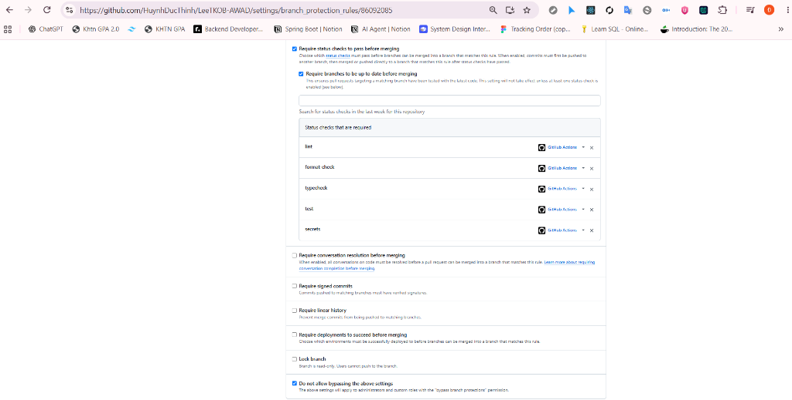

# Cấu hình Bảo vệ Nhánh `main` (`docs/evidence/branch-protection.md`)

Quy tắc bảo vệ nhánh `main` trên repository công khai [`HuynhDucThinh/LeeTKOB-AWAD`](https://github.com/HuynhDucThinh/LeeTKOB-AWAD).

## Các quy tắc bắt buộc được áp dụng trên `refs/heads/main`

1. **Require a pull request before merging:** Bắt buộc mọi thay đổi phải đi qua Pull Request (không ai được phép `git push origin main` trực tiếp).
2. **Require status checks to pass before merging** (`strict: true` — nhánh phải cập nhật mới nhất với `main`) với đủ **5 cổng kiểm tra** từ GitHub Actions:
   - `lint` (`npm run lint`)
   - `format-check` (`npm run format:check`)
   - `typecheck` (`npm run typecheck`)
   - `test` (`npm test`)
   - `secrets` (`npm run sec:scan` + Gitleaks `8.30.1` trên toàn bộ lịch sử)
3. **Do not allow bypassing the above settings (`enforce_admins: true`):** Kể cả chủ sở hữu repository (`HuynhDucThinh`) cũng bị chặn.
4. `allow_force_pushes: false`, `allow_deletions: false`.

Kiểm chứng lại bất cứ lúc nào (repo public, không cần token):

```sh
curl -s https://api.github.com/repos/HuynhDucThinh/LeeTKOB-AWAD/branches/main | jq .protection
```

## Bằng chứng merge bị chặn

| PR | Lý do đỏ | Run đỏ | Thông báo khi cố merge | Commit sửa → run xanh |
| :--- | :--- | :--- | :--- | :--- |
| [#1](https://github.com/HuynhDucThinh/LeeTKOB-AWAD/pull/1) | break cố ý: replay trả `201` | [42766034224](https://github.com/HuynhDucThinh/LeeTKOB-AWAD/actions/runs/42766034224) | `Required status check "test" is failing` | `53e8b6d` → [42766200407](https://github.com/HuynhDucThinh/LeeTKOB-AWAD/actions/runs/42766200407) |
| [#2](https://github.com/HuynhDucThinh/LeeTKOB-AWAD/pull/2) | break cố ý: bỏ join `ta_classes` | [42766403260](https://github.com/HuynhDucThinh/LeeTKOB-AWAD/actions/runs/42766403260) | `Required status check "test" is failing` | `58d8bcb` → [42766615499](https://github.com/HuynhDucThinh/LeeTKOB-AWAD/actions/runs/42766615499) |
| [#4](https://github.com/HuynhDucThinh/LeeTKOB-AWAD/pull/4) | **lỗi thật**: auth fail-open (`AI-LOG A09`) | [42769824380](https://github.com/HuynhDucThinh/LeeTKOB-AWAD/actions/runs/42769824380) | `gh pr merge 4` → `the base branch policy prohibits the merge` (`mergeStateStatus: BLOCKED`) | `f70f2fe` → [42769997105](https://github.com/HuynhDucThinh/LeeTKOB-AWAD/actions/runs/42769997105) |

## File bằng chứng đi kèm

- Ảnh chụp trang cấu hình rule của `main` (Settings → Branches → rule `main`, URL `.../settings/branch_protection_rules/86092085`): 
  Ảnh cho thấy: *Require status checks to pass before merging*, *Require branches to be up to date before merging*, 5 check bắt buộc (`lint`, `format-check`, `typecheck`, `test`, `secrets`, nguồn GitHub Actions) và **Do not allow bypassing the above settings**. Các mục không nằm trong khung ảnh (*Require a pull request before merging*, force push và deletions bị tắt) được xác nhận bằng file JSON bên dưới.
- Cấu hình JSON xuất từ GitHub REST API: [`main-protection.json`](main-protection.json)
- Nhật ký thực nghiệm cổng kiểm tra chặn merge: [`gate-experiments.json`](gate-experiments.json)
