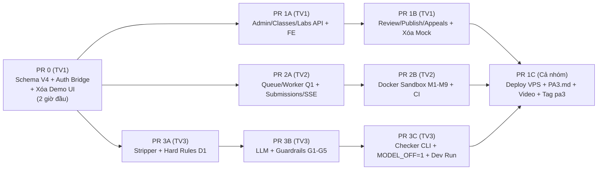

# Kế hoạch Chia việc 3 Thành viên & Hợp đồng API Thống nhất (`PA#3` → Nền tảng `PA#4`–`PA#6`)

> **Mục tiêu:** Hoàn thành **100% tiêu chí Rubric `PA#3`** + xây dựng **đầy đủ toàn bộ chức năng nghiệp vụ ứng dụng (`F1`–`F10`)** khớp với giao diện Frontend hiện có (bao gồm cả Appeals, xóa sạch mock & demo UI), đồng thời đặt sẵn các móc nối (`trace_id`, `idempotency_key`, `cost_cap_usd`, `version`) để sang **PA#4** (Eval Gate CI, Red-team) và **PA#5** (Observability, Load test 80 bài) chỉ cần cắm thêm mà **không phải đập đi xây lại**.

---

## 1. Nguyên tắc Chia việc & Chuẩn bị cho Vấn đáp Cá nhân (`PA#6`)

Mỗi thành viên phụ trách **trọn gói chiều dọc (Vertical Slice)** gồm: **Backend + Tests (viết trước/cùng commit) + Nối API thật trên các màn hình Frontend tương ứng + Cập nhật `AI-LOG.md`**.
Cách chia này đảm bảo:
- **Làm song song không dẫm chân nhau** nhờ chốt cứng **Hợp đồng API (Mục 3)** và **Interface Java nội bộ (Mục 4)** ngay từ **PR 0**.
- **Cân bằng tuyệt đối cho vấn đáp `PA#6` (`OWNERS.md` + `git log --author`):** Mỗi người đều nắm 1 trụ cột kỹ thuật sâu (RBAC/Human Gate/Appeals — Queue/Worker/Sandbox — Hard Rules/LLM/Guardrails/Eval) để trả lời tốt cả 4 mảng câu hỏi A, B, C, D.

| Thành viên (Gợi ý phân công) | Trụ cột Kỹ thuật sở hữu (PA#3 → PA#6) | Tỷ trọng Rubric PA#3 | Mở rộng tự nhiên sang PA#4 & PA#5 |
| :--- | :--- | :---: | :--- |
| **Thành viên 1**<br>**Trà Văn Sỹ** (`23120197`) | **Core Platform, RBAC/Ownership (`T1`), Admin/Classes/Labs (`F1, F2`), Review Queue & Human Gate (`F8`, `H1–H3`), Publish & Appeals (`F9`, `A1–A3`), Public Deployment** | Tiêu chí **1** (15đ) + phần **5** (5đ) + Deploy | PA#4: Hoàn thiện `H1–H3` & phần *Where we stop it*<br>PA#5: Deploy HTTPS `pa5`, Appeals walkthrough, Post-mortem |
| **Thành viên 2**<br>**Lê Trung Thành Đạt** (`23120228`) | **Async Queue & Separate Worker (`Q1`), C++ Docker Sandbox 9 Minimums (`F4`, `M1–M9`) + 9 Attack `.cpp` trong CI, Submissions API & Real-time SSE (`F3`)** | Tiêu chí **2** (20đ) + phần **1** (luồng Submit/SSE) | PA#4: Red-team Sandbox/Auth nhóm khác<br>PA#5: **Load test 80 SV** (`load/`) + Metrics/Traces Worker |
| **Thành viên 3**<br>**Huỳnh Đức Thịnh** (`23120199`) | **Constraint Checker Core (`com.leetkob.checker.*`): Stripper + Line Map, Hard Rules syntax-aware (`F5`, `D1`), Real LLM + Call Log (`F6`), Guardrails (`F7`, `G1–G5`), Checker CLI (`MODEL_OFF=1`) + `Dockerfile` + Dev Set Run (`F10`)** | Tiêu chí **3** (15đ) + **4** (20đ) + **5** (5đ) + **6** (10đ) | PA#4: **Eval Gate CI**, 10 custom cases, **Held-out run**<br>PA#5: Metrics chi phí LLM & tỷ lệ `unsure` |

*(Cả 3 thành viên cùng chịu trách nhiệm Tiêu chí **7** — Tests first, one part per commit [5đ] và Tiêu chí **8** — `AI-LOG.md` [5đ] cho phần mình code).*

---

## 2. Phân công Chi tiết Từng Thành viên (Từng PR, File, Test & Frontend)

### Bước khởi động chung — PR 0 (`feat/pa3-foundation-schema-auth`) — *Thành viên 1 mở trước (~2 giờ), cả nhóm pull về rồi tách nhánh song song*
> **Mục tiêu:** Mở khóa cho cả 3 người chạy song song mà không bị xung đột migration DB hay filter HTTP.

- **DB Migrations (chốt 1 lần cho toàn bộ app `F1`–`F9`):**
  - Tạo `V4__pa3_full_app_schema.sql` (PostgreSQL) & đồng bộ tương thích vào `backend/src/main/resources/schema.sql` (H2 test) **mà không sửa bất kỳ cột nào của PA#2**:
    - Mở rộng `labs`: `title`, `statement_md`, `cost_cap_usd`, `created_by`, `created_at` (giữ `id` hỗ trợ identity + explicit insert).
    - Tạo mới: `lab_tests`, `lab_constraints`, `submissions` (có sẵn `trace_id`, `idempotency_key`), `judge_jobs` (có sẵn `trace_parent` cho PA#5), `llm_call_logs`, `appeals` (cho `F9`).
    - Mở rộng `review_items` (có default/nullable để 23 contract tests PA#2 vẫn xanh): `verdict`, `source`, `evidence_json`, `guardrail_reason`, `in_queue DEFAULT TRUE`, `sampled_pass DEFAULT FALSE`, `decided_by`, `decided_at`.
- **Cầu nối Auth & Filter trên `/v1/**`:**
  - Thu hẹp `shouldNotFilter` của `PublishController` để chỉ chặn các route `/v1/labs/*/publish` (vẫn pass 100% 23 Contract Tests PA#2, kể cả path sai như `/v1/labs/01/publish` hay `/v1/labs/1/publish/`).
  - Tạo `CompositeAuthResolver` (ưu tiên đọc JWT Bearer/Cookie → `Principal(email, role)`, fallback `DemoAuthAdapter` cho `DEMO_AUTH_TOKEN`).
  - Gỡ default hardcoded secret khỏi `JwtUtil.java` (đọc từ `JWT_SECRET`, đặt test fixture ở `src/test/resources/config/application.properties`), dọn `backend/.env.example` và `.env.example` chỉ còn tên biến.
  - Tạo sẵn **2 Java Interface cốt lõi** trong `com.leetkob.sandbox.SandboxRunner` và `com.leetkob.checker.ConstraintCheckPipeline` (Mục 4) để Thành viên 2 & 3 code song song.
- **Dọn Demo UI & Sửa Axios Refresh trên Frontend:**
  - Sửa [api.ts](file:///e:/Courses/AWAD/Project/LeeTKOB-AWAD/frontend/src/services/api.ts#L77-L84) gọi lại `authService.refreshToken()` thay vì `/v1/auth/refresh-token`.
  - Xóa cụm nút chuyển role nhanh `ADMIN | TA | STUDENT` khỏi [DashboardLayout.tsx](file:///e:/Courses/AWAD/Project/LeeTKOB-AWAD/frontend/src/layouts/DashboardLayout.tsx).
  - Xóa khu vực `Test accounts` và pre-fill email/password khỏi [AuthPage.tsx](file:///e:/Courses/AWAD/Project/LeeTKOB-AWAD/frontend/src/pages/auth/AuthPage.tsx).

---

### Thành viên 1 (Trà Văn Sỹ) — Core Platform, Admin/Classes/Labs, Review Queue, Publish, Appeals & Deploy

| PR / Nhánh | Commit (Tests first / One part per commit) | Phạm vi Backend & Tests | Phạm vi Frontend (Bật `// REAL API` & Xóa mock) |
| :--- | :--- | :--- | :--- |
| **PR 1A**<br>`feat/pa3-admin-classes-labs` | **C1:** Tests `T1` (TA lớp khác → `404`, Student → `403`, Admin quản lý lớp/user).<br>**C2:** `AdminController`, `ClassController`, `LabController`, `VersionController` + RFC 9457 error handler chung cho `/v1/**`.<br>**C3:** Nối Frontend thật. | - `GET/POST /v1/admin/classes`<br>- `PUT /v1/admin/classes/{id}/members` (đồng bộ `class_members` ↔ `ta_classes`)<br>- `GET/POST /v1/admin/users`<br>- `GET /v1/classes`<br>- `GET/POST/PUT /v1/labs`, `GET /v1/labs/{id}`<br>- `GET /v1/version` | - Bật `// REAL API` trong: `adminService.ts`, `classService.ts`, `labService.ts`, `versionService.ts`.<br>- Kiểm tra hoạt động thật trên: `AdminClassesPage`, `AdminUsersPage`, `MyClassesPage`, `TaLabsPage`, `TaLabFormPage`, `TaLabDetailPage`, `StudentLabsPage`. |
| **PR 1B**<br>`feat/pa3-review-publish-appeals` | **C1:** Tests `H1–H3` (10% random pass với fixed seed, Publish chặn khi còn unreviewed, chặn TA lớp khác/student) & `A1–A3` (appeal trước publish → `409`, appeal bài SV khác → `404`/`403`, quyết định lưu `decidedBy/At/Reason` và đổi `published_marks`).<br>**C2:** `ReviewQueueController`, `ReviewQueueService` (cập nhật `PublishService` đọc `in_queue = TRUE`), `AppealController`, `AppealService`.<br>**C3:** Nối Frontend thật & xóa sạch `src/services/mock/` (sau khi PR 2 cũng xong). | - `GET /v1/labs/{labId}/review-queue`<br>- `PUT /v1/labs/{labId}/review-queue/{subId}/{cid}`<br>- `POST /v1/labs/{labId}/publish` (tương thích 100% PA#2)<br>- `GET /v1/labs/{labId}/appeals`<br>- `POST /v1/submissions/{id}/appeals`<br>- `PUT /v1/appeals/{id}/decision` | - Bật `// REAL API` trong: `reviewService.ts`, `publishService.ts`, `appealService.ts`.<br>- Kiểm tra thật trên: `TaReviewQueuePage`, `TaAppealsPage`, phần xem điểm & gửi Appeal ở `StudentLabDetailPage`.<br>- Xóa hẳn thư mục `frontend/src/services/mock/` và biến `USE_MOCK_API`. |
| **PR 1C**<br>`ops/pa3-deploy-release` | **C1:** `docker-compose.prod.yml` (Caddy HTTPS + Postgres + `api` + `worker`) + build static Frontend.<br>**C2:** `PA3.md`, tổng hợp `SELF_ASSESSMENT_REPORT.md`, `AI-LOG.md` → gắn tag `pa3`. | Deploy công khai lên VPS, chạy thử luồng `sort-merge` (3 bài nộp) + kiểm tra 5 tài khoản PA#3. | Kiểm tra toàn bộ UI trên URL công khai (F5 giữ dữ liệu, Network tab gọi API thật). |

---

### Thành viên 2 (Lê Trung Thành Đạt) — Async Queue, Separate Worker (`Q1`), C++ Docker Sandbox (`M1–M9`) & Submissions/SSE

| PR / Nhánh | Commit (Tests first / One part per commit) | Phạm vi Backend & Tests | Phạm vi Frontend (Bật `// REAL API`) |
| :--- | :--- | :--- | :--- |
| **PR 2A**<br>`feat/pa3-queue-and-worker` | **C1 (Tests first):** `JudgeWorkerExactOnceTest` (test `Q1`: dừng worker → tạo submission → bật worker lại → chấm và lưu **đúng 1 bộ verdict**; test idempotency key không tạo trùng submission).<br>**C2:** `JudgeJobRepository` (`FOR UPDATE SKIP LOCKED`), `JudgeWorker` (chạy tách biệt qua `LEETKOB_ROLE=worker`, polling `250ms`, gọi `SandboxRunner` → nếu `AC` gọi `ConstraintCheckPipeline` → lưu `review_items` nguyên tử).<br>**C3:** `SubmissionController` (`POST/GET`, SSE `/events`) + `SubmissionEventBroadcaster` + nối Frontend. | - `POST /v1/labs/{labId}/submissions` (enqueue `judge_jobs`, hỗ trợ `Idempotency-Key`, tạo `traceId`, ẩn `publishedDeductions` trước Publish)<br>- `GET /v1/labs/{labId}/submissions`<br>- `GET /v1/submissions/{id}`<br>- `GET /v1/submissions/{id}/events` (SSE real-time `queued → running → AC/WA/...`) | - Bật `// REAL API` trong: `submissionService.ts` (xóa hàm `mockAdvance`) và `useSubmissionStream.ts` (bật `EventSource` thật).<br>- Kiểm tra thật trên `StudentLabDetailPage` (nộp bài, không F5 vẫn nhảy trạng thái từ `queued` → `running` → `AC`/`WA`/`CE`). |
| **PR 2B**<br>`feat/pa3-cpp-sandbox` | **C1 (Tests first):** 9 file attack C++ trong `backend/src/test/resources/sandbox-attacks/` (`m1_network.cpp` → `m9_no_secrets.cpp`, đặc biệt `m4_memory_oom.cpp` phải dùng `volatile` ghi & đọc lại 1 GiB) + `DockerSandboxSecurityTest` (`@Tag("sandbox")`).<br>**C2:** `sandbox/Dockerfile` (`debian:bookworm-slim` + `g++`, user non-root `10001`, không curl/secret) + `DockerSandboxRunner` (biên dịch & chạy trong container: `--network=none`, `--memory=256m --memory-swap=256m`, `--pids-limit=32`, `--read-only --tmpfs /work`, `--user 10001:10001`, `--cap-drop=ALL`, `docker cp` không host mount, wall-clock gọi `docker kill`, env trắng).<br>**C3:** Thêm job `sandbox-tests` vào `.github/workflows/ci.yml` để 9 attack tests chạy xanh trên GitHub Actions (tag `pa3`). | Nối `DockerSandboxRunner` thật vào `JudgeWorker` (có cấu hình fallback mock runner chỉ trong `src/test` khi chạy unit test không có Docker). | Kiểm tra hiển thị `compileError`, `executionTimeMs`, `memoryKb`, `passedTests/totalTests` trên `StudentLabDetailPage` & `TaLabDetailPage`. |

---

### Thành viên 3 (Huỳnh Đức Thịnh) — Constraint Checker Core, Hard Rules (`D1`), Real LLM + Guardrails (`G1–G5`) & Checker CLI (`F10`)

| PR / Nhánh | Commit (Tests first / One part per commit) | Phạm vi Backend / Checker & Tests | Phạm vi Frontend / Eval |
| :--- | :--- | :--- | :--- |
| **PR 3A**<br>`feat/pa3-hard-rules` | **C1 (Tests first):** `StripperLineMapUnitTest` + `HardRuleTrapsUnitTest` (phủ đầy đủ ban-list `"Do not use"` / `"Do not call"` + mọi bẫy: `sort` tự viết/namespace riêng, comment `//`/`/* */`, string `"std::sort"`, `#include <algorithm>` chỉ dùng `std::swap`, và assert **0 LLM calls** khi hard rule đã quyết định).<br>**C2:** `CppCommentPiiStripper` (giữ nguyên số dòng `\n` để map về code gốc) + `CppLexer` + `BanListHardRuleChecker` (syntax-aware, đọc động từ `constraints`, không hardcode tên bài dev-set). | Package `com.leetkob.checker.strip` và `com.leetkob.checker.hard` (thuần Java, không phụ thuộc Spring). | *(Chưa chạm FE ở PR này)* |
| **PR 3B**<br>`feat/pa3-llm-and-guardrails` | **C1 (Tests first):** `GuardrailsFakeModelUnitTest` (dùng **fake model, 0 gọi mạng**) kiểm chứng đủ 5 guardrails:<br>- **G1 Schema:** JSON lỗi, code fence, verdict lạ, thiếu/trùng constraint → `unsure (schema_invalid)`<br>- **G2 Evidence:** dòng bịa, đúng chữ sai số dòng, dòng chỉ có trong comment đã strip → `unsure (evidence_mismatch)`<br>- **G3 Timeout:** vượt thời gian chờ → `unsure (timeout)`<br>- **G4 Cost cap:** vượt `cost_cap_usd` → `unsure (cost_cap_exceeded)`<br>- **G5 No deduction:** model trả `"deduction": 0` bị bỏ qua hoàn toàn.<br>**C2:** `RealLlmClient` (chỉ gửi `statement`, `constraints`, `strippedCode` đánh số dòng), `LlmCallLogger` (ghi JSONL & bảng `llm_call_logs` có `provider_request_id`, model, tokens, latency, cost), `ConstraintCheckPipeline` ghép Strip → Hard Rules → LLM → Guardrails → trả kết quả cho Worker. | Package `com.leetkob.checker.llm`, `com.leetkob.checker.guardrail`, `com.leetkob.checker.ConstraintCheckPipeline`. | Kiểm tra hiển thị badge `hard_rule`/`llm`/`guardrail`, highlight dòng `evidence` trong `CppCodeViewer`, `guardrailReason`, và thanh `CostCapBar` trên `TaReviewQueuePage` & `TaLabDetailPage`. |
| **PR 3C**<br>`feat/pa3-checker-cli-and-eval` | **C1:** Commit nguyên vẹn bộ `eval/dev/` từ Classroom (kiểm SHA-256: `eval.mjs` bắt đầu `c836edd8713521bb`, `labels.jsonl` bắt đầu `262cda7b0ef5612e`) + tạo `eval/custom-cases/` (≥ 5 case có gắn tag, tối thiểu 1 `trap` & 1 `injection`).<br>**C2:** `CheckerCliMain` (đọc `statement.md` + `constraints.json` + `.cpp`, hỗ trợ `MODEL_OFF=1` không mở mạng) + task Gradle `checkerCliJar` + `checker/Dockerfile` + test chạy `docker run --network none -e MODEL_OFF=1` chấm bằng `node eval.mjs` (0 wrongful deductions, exit `0` hoặc `1`).<br>**C3:** Chạy 1 lần **real model** trên `eval/dev/`, commit `eval/runs/pa3-dev-run/` (`predictions.jsonl`, `eval-report.txt`, `call-log.jsonl` có `provider_request_id`), cập nhật tên model + phép tính chi phí 1 lab 80 bài vào `README.md` & `AI-LOG.md`. | Package `com.leetkob.checker.cli` + `checker/Dockerfile` + `eval/`. | Đảm bảo kết quả chạy CLI khớp 100% logic Worker vì dùng chung `ConstraintCheckPipeline`. |

---

## 3. Hợp đồng API Thống nhất 1-1 giữa Frontend và Backend (Locked Contract)

> **Quy ước chung bắt buộc cho cả 3 thành viên:**
> - **JSON naming:** `camelCase` cho toàn bộ Request/Response JSON.
> - **Thời gian:** UTC ISO-8601 (`2026-11-24T10:00:00.000Z`).
> - **Điểm số:** Số nguyên `scoreTenths` / `deductionTenths` trong `[0..100]` (tương ứng `0.0` – `10.0`).
> - **Xác thực trên `/v1/**`:** Đọc JWT từ `Authorization: Bearer <accessToken>` hoặc HttpOnly Cookie `access_token` (đã có trong `JwtAuthenticationFilter`). Riêng `POST /v1/labs/{labId}/publish` hỗ trợ thêm `DEMO_AUTH_TOKEN` cho PA#2 contract tests.
> - **Mọi lỗi 4xx/5xx trên `/v1/**` bắt buộc trả RFC 9457 (`Content-Type: application/problem+json`)** kèm `Cache-Control: no-store`, `X-Content-Type-Options: nosniff`:
>   ```json
>   {
>     "type": "https://leetkob.example/problems/<slug>",
>     "title": "<Fixed Title>",
>     "status": 404,
>     "detail": "<Safe human-readable message>",
>     "instance": "/v1/..."
>   }
>   ```
> - **Quy tắc cô lập lớp (`T1`):** TA không thuộc lớp của `labId` → **luôn trả `404 not-found`** với body y hệt lab không tồn tại. Student gọi API của TA/Admin hoặc Admin gọi API của TA → **`403 forbidden`**.

### 3.1. Auth & Version (Đã có `/api/auth/**` + bổ sung `/v1/version`)

| Method & Path | Role | Request Body | Response `200/201` (Khớp `frontend/src/types/`) | Lỗi RFC 9457 |
| :--- | :---: | :--- | :--- | :--- |
| `POST /api/auth/login` | Public | `{ "email": "...", "password": "..." }` | `ApiResponse<{ accessToken, user }>` *(đã chạy thật)* | `401` |
| `POST /api/auth/refresh-token` | Cookie | `{}` | `ApiResponse<{ accessToken, user }>` *(đã chạy thật)* | `401` |
| `POST /api/auth/logout` | Any | `{}` | `ApiResponse<null>` + xóa cookie *(đã chạy thật)* | — |
| `GET /v1/version` | Public | — | `{ "commit": "a1b2c3d", "tag": "pa3", "deployedAt": "..." }` (`VersionInfo`) | — |

### 3.2. Admin & Classes (`F1`) — *Thành viên 1*

| Method & Path | Role | Request Body | Response `200/201` (Khớp `types/admin.ts`, `types/auth.ts`) | Lỗi RFC 9457 |
| :--- | :---: | :--- | :--- | :--- |
| `GET /v1/admin/classes` | `admin` | — | `ClassRoom[]`: `[{ id, name, taIds, studentIds, labCount }]` | `401`, `403` |
| `POST /v1/admin/classes` | `admin` | `{ "name": "CSC13114-C" }` | `201` `ClassRoom` | `400 validation`, `403` |
| `PUT /v1/admin/classes/{classId}/members` | `admin` | `{ "taIds": ["uuid1"], "studentIds": ["uuid2"] }` | `200` `ClassRoom` *(BE đồng bộ cả `class_members` và `ta_classes`)* | `400`, `403`, `404` |
| `GET /v1/admin/users?role=` | `admin` | Query `role` tùy chọn (`admin\|ta\|student`) | `AuthUser[]`: `[{ id, username, displayName, role, classIds, createdAt }]` *(map `username = email`, `displayName = fullName`)* | `401`, `403` |
| `POST /v1/admin/users` | `admin` | `{ "username": "email@...", "displayName": "...", "role": "ta", "password": "..." }` | `201` `AuthUser` | `400 validation`, `409` (trùng email) |
| `GET /v1/classes` | `ta`, `student`, `admin` | — | `ClassRoom[]` (các lớp user hiện tại thuộc `class_members`; admin thấy tất cả) | `401` |

### 3.3. Labs (`F2`, `T1`) — *Thành viên 1*

| Method & Path | Role | Request Body | Response `200/201` (Khớp `types/lab.ts`) | Lỗi RFC 9457 |
| :--- | :---: | :--- | :--- | :--- |
| `GET /v1/labs` | `ta`, `student`, `admin` | — | `LabSummary[]`: `[{ id, classId, className, title, deadline, costCapUsd, costSpentUsd, isPublished, publishedAt, submissionCount, judgingPendingCount, unreviewedCount }]` *(chỉ trả lab thuộc lớp của user)* | `401` |
| `GET /v1/labs/{labId}` | `ta`, `student` | — | `LabDetail` (`LabSummary` + `statementMd`, `tests[]`, `constraints[]`, `publicationReceipt`). *Lưu ý: với `student`, chỉ trả `tests` có `isSample = true` (ẩn hidden test).* | `401`, **`404` (TA/SV lớp khác)** |
| `POST /v1/labs` | `ta` | `CreateLabPayload`: `{ classId, title, deadline, costCapUsd, statementMd, tests: [{ name, input, expectedOutput, timeLimitMs, memoryLimitMb, isSample }], constraints: [{ constraintId, type, description, deductionTenths }] }` | `201` `LabDetail` | `400 validation`, `403` (non-TA), **`404` (TA không phụ trách `classId`)** |
| `PUT /v1/labs/{labId}` | `ta` | `CreateLabPayload` | `200` `LabDetail` | `400`, `403`, **`404` (TA lớp khác)** |

### 3.4. Submissions & Real-time SSE (`F3`, `Q1`) — *Thành viên 2*

| Method & Path | Role | Request Body / Headers | Response `200/201` (Khớp `types/submission.ts`) | Lỗi RFC 9457 |
| :--- | :---: | :--- | :--- | :--- |
| `POST /v1/labs/{labId}/submissions` | `student` | Header: `Idempotency-Key` (optional)<br>Body: `{ "sourceCode": "#include ..." }` | `201` `SubmissionSummary`: `{ id, labId, studentId, studentName, judgeStatus: "queued", scoreTenths: 0, publishedScoreTenths: null, isCounted: true, passedTests: 0, totalTests, executionTimeMs: null, memoryKb: null, compileError: null, submittedAt, judgedAt: null, traceId }` | `400`, `403`, `404` (SV lớp khác), `409 deadline-passed`, `413` |
| `GET /v1/labs/{labId}/submissions` | `ta`, `student` | — | `SubmissionSummary[]` *(Student chỉ thấy bài của chính mình; TA thấy tất cả bài của lab lớp mình; `publishedScoreTenths` luôn `null` nếu lab chưa Publish)* | `401`, `404` |
| `GET /v1/submissions/{submissionId}` | `ta`, `student` | — | `SubmissionDetail` (`SubmissionSummary` + `sourceCode`, `strippedCode`, `publishedDeductions`). **Bắt buộc:** `publishedDeductions = null` và `publishedScoreTenths = null` nếu lab chưa Publish! | `401`, `404` (SV xem bài người khác / TA lớp khác) |
| `GET /v1/submissions/{submissionId}/events` | `ta`, `student` | Cookie JWT (`EventSource` `withCredentials: true`) | `Content-Type: text/event-stream`<br>Mỗi event `data: <JSON>` kiểu `JudgeStatusSseEvent`: `{ submissionId, labId, judgeStatus, passedTests, totalTests, executionTimeMs, memoryKb, compileError, scoreTenths, judgedAt }`. Tự đóng stream khi đạt trạng thái cuối (`AC/WA/TLE/MLE/RE/CE`). | `401`, `404` |

### 3.5. Review Queue, Publish & Appeals (`F8`, `F9`, `H1–H3`, `A1–A3`) — *Thành viên 1*

| Method & Path | Role | Request Body | Response `200/201` (Khớp `types/review.ts`, `types/publish.ts`, `types/appeal.ts`) | Lỗi RFC 9457 |
| :--- | :---: | :--- | :--- | :--- |
| `GET /v1/labs/{labId}/review-queue` | `ta` | Query tùy chọn `page`, `size` | `ReviewQueuePageResponse`: `{ items: ReviewItem[], total, page, size }`<br>Mỗi `ReviewItem`: `{ submissionId, labId, studentId, constraintId, constraintType, constraintDescription, deductionTenths, verdict, source, evidence: [{line, text}], guardrailReason, sampledPass, decision, decidedBy, decidedAt, sourceCode, strippedCode }` | `401`, `403` (SV/Admin), **`404` (TA lớp khác)** |
| `PUT /v1/labs/{labId}/review-queue/{submissionId}/{constraintId}` | `ta` | `{ "decision": "pass" \| "violation" }` | `200` `ReviewItem` (đã cập nhật `decision`, `decidedBy`, `decidedAt`) | `400`, `403`, `404` |
| `POST /v1/labs/{labId}/publish` | `ta` | `{}` *(Giữ nguyên 100% hợp đồng `docs/contract/publish-lab.md`)* | `200` `PublicationReceipt` + header `Idempotent-Replayed: true` khi replay | 13 mã lỗi PA#2 (`409 deadline-not-reached`, `judging-pending`, `reviews-pending`, `404`, `403`, ...) |
| `GET /v1/labs/{labId}/appeals` | `ta`, `student` | — | `AppealItem[]` *(Student chỉ thấy appeal của chính mình; TA thấy tất cả của lab lớp mình)* | `401`, `404` |
| `POST /v1/submissions/{submissionId}/appeals` | `student` | `{ "constraintId": "C1", "reason": "..." }` | `201` `AppealItem` | `403`/`404` (bài người khác — `A2`), **`409 appeal-before-publish` (`A1`)**, `409 appeal-already-exists` |
| `PUT /v1/appeals/{appealId}/decision` | `ta` | `{ "status": "accepted" \| "rejected", "decisionReason": "..." }` | `200` `AppealItem` *(nếu `accepted`, cập nhật `published_marks` và lưu `decidedBy`, `decidedAt`, `decisionReason` — `A3`)* | `400` (thiếu lý do), `403`, `404` |

---

## 4. Hợp đồng Interface Java Nội bộ (Giữa Thành viên 2 và Thành viên 3)

Được định nghĩa sẵn ở **PR 0** để Thành viên 2 (Worker) và Thành viên 3 (Checker Core) làm hoàn toàn độc lập:

```java
// 1. Giao diện Sandbox (Thành viên 2 cài đặt trong com.leetkob.sandbox.DockerSandboxRunner)
public interface SandboxRunner {
  SandboxRunResult compileAndRun(String sourceCode, List<TestCaseSpec> tests);
}
public record SandboxRunResult(
    String judgeStatus,       // "AC", "WA", "TLE", "MLE", "RE", "CE"
    int passedTests,
    int totalTests,
    Integer executionTimeMs,
    Integer memoryKb,
    String compileError) {}

// 2. Giao diện Checker Core (Thành viên 3 cài đặt trong com.leetkob.checker.ConstraintCheckPipeline)
public interface ConstraintCheckPipeline {
  CheckPipelineResult check(CheckRequest request);
}
public record CheckRequest(
    String solutionKey,       // VD: "submission-105" hoặc "sort-merge/s03"
    String statementMd,
    String sourceCode,
    List<String> piiTokensToStrip, // email/tên SV cần ẩn (rỗng khi chạy CLI)
    List<ConstraintSpec> constraints,
    BigDecimal remainingBudgetUsd,
    boolean modelOff) {}

public record CheckPipelineResult(
    String strippedCode,
    List<ConstraintVerdictResult> verdicts, // 1 phần tử cho mỗi constraint
    List<LlmCallRecord> callLogs) {}        // rỗng nếu chỉ chạy hard rule hoặc modelOff
```

---

## 5. Tiến độ thực hiện đề xuất (Kịp hạn `PA#3`: 22:00 Thứ Tư 25/11/2026)



### 5.2. Cơ chế chạy SONG SONG 3 người không xung đột Git

Plan này được thiết kế để **chạy song song 100% ngay sau khi `PR 0` merge vào `main`**:
- **Giai đoạn 1 (Tuần tự — ~1–2 giờ): Chỉ làm `PR 0`**. `PR 0` khóa cứng toàn bộ DB schema (`V4` + `schema.sql`), `CompositeAuthResolver`, filter `PublishController`, **2 Java interfaces** (`SandboxRunner`, `ConstraintCheckPipeline`), và dọn UI demo.
- **Giai đoạn 2 (Song song hoàn toàn):** Cả 3 người cùng `git pull origin main` sau `PR 0`, tách 3 nhánh riêng, mỗi người làm trên thư mục/package độc lập:
  - **Trà Văn Sỹ (`TV1`):** `controllers/{Admin,Class,Lab,ReviewQueue,Appeal,Version}Controller`, `services/{admin,lab,review,publish,appeal}`, FE `admin/class/lab/review/publish/appeal/versionService.ts`.
  - **Lê Trung Thành Đạt (`TV2`):** `worker/`, `sandbox/`, `controllers/SubmissionController`, `services/submission/`, `sandbox/Dockerfile`, FE `submissionService.ts` + `useSubmissionStream.ts`.
  - **Huỳnh Đức Thịnh (`TV3`):** `checker/` (`strip/`, `hard/`, `llm/`, `guardrail/`, `cli/`), `checker/Dockerfile`, `eval/`. *(Gần như 0 đụng file với TV1 và TV2).*
- **2 quy tắc nhỏ để không bao giờ bị lỗi compile chéo lúc merge:**
  1. `JudgeWorker` (`TV2`) inject 2 interface `SandboxRunner` và `ConstraintCheckPipeline` từ `PR 0` qua Spring `ObjectProvider<...>` (nếu `TV3` chưa merge `PR 3B`, `JudgeWorker` vẫn build và chạy bình thường).
  2. **Thư mục `frontend/src/services/mock/` chỉ được xóa ở PR cuối** (hoặc sau khi cả `PR 1B` của Sỹ và `PR 2A` của Đạt đã merge), để trong lúc làm song song không ai làm gãy `tsc` của service người còn lại.

### 5.3. Checklist bắt buộc trước khi gắn tag `pa3`
- [ ] Cả 3 thành viên đều có commit mang tên git riêng của mình trên `main` (merge bằng **Create a merge commit**, không squash).
- [ ] Không còn file nào trong `frontend/src/services/mock/`, không còn nút chuyển role `ADMIN | TA | STUDENT`, không còn `Test accounts` ở trang Login.
- [ ] Cả 6 cổng CI xanh trên tag `pa3`: `lint`, `format-check`, `typecheck`, `test`, `secrets`, `sandbox-tests` (đủ 9 attacks `M1–M9`).
- [ ] Chạy `docker run --network none -e MODEL_OFF=1 ...` trên `eval/dev/` và chấm bằng `node eval.mjs` đạt **0 wrongful deductions**, exit code `0` hoặc `1`.
- [ ] Đã commit 1 lần chạy thật trên `eval/dev/` (có `provider_request_id` thật trong `call-log.jsonl`) + phép tính chi phí 1 lab 80 bài trong `README.md` và `AI-LOG.md`.
- [ ] Bản deploy công khai chạy ổn định, có `PA3.md`, `SELF_ASSESSMENT_REPORT.md`, video dự phòng ≤ 5 phút, và nén zip **có cả `.git`** đúng tên `23120197-23120199-23120228_<total>.zip`.
